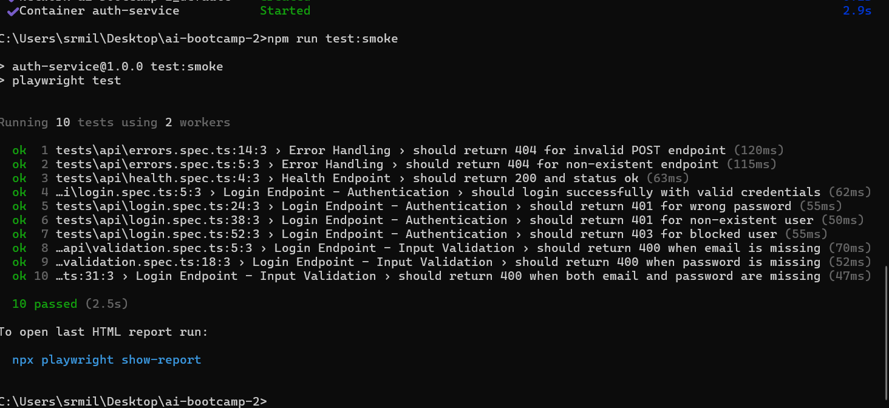
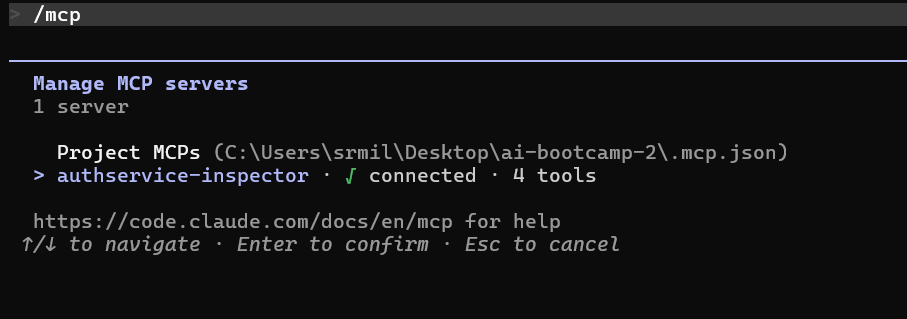
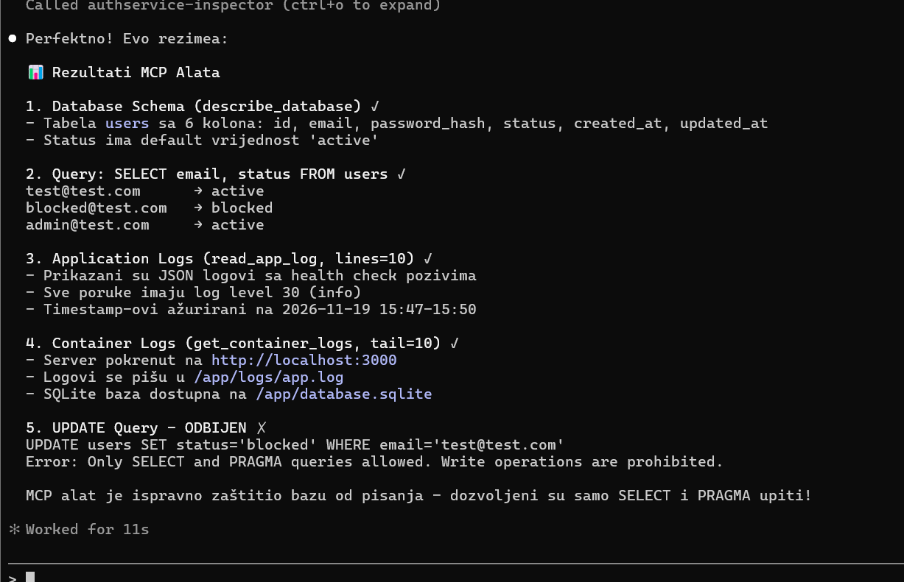
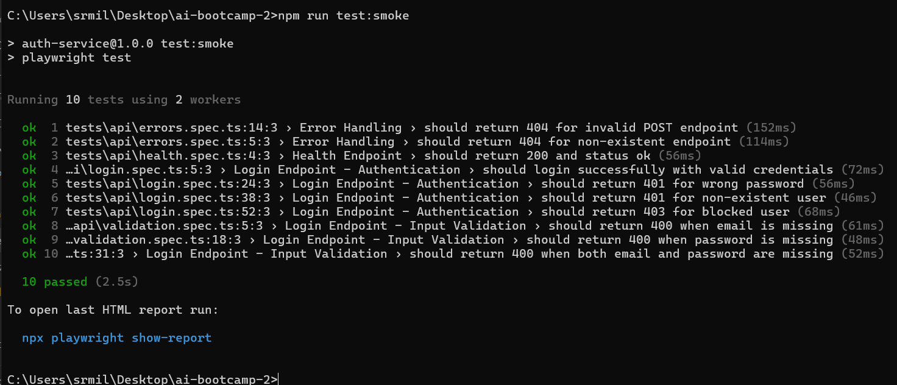
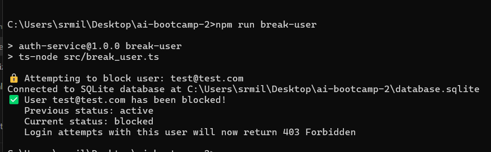
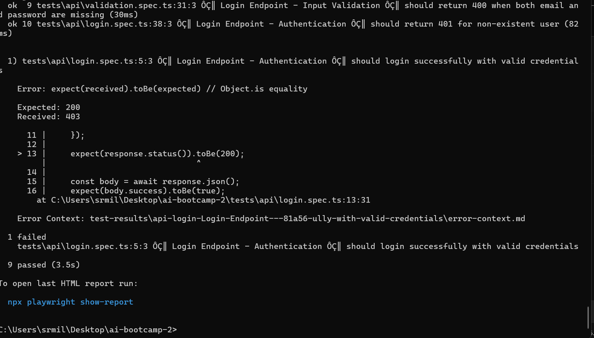
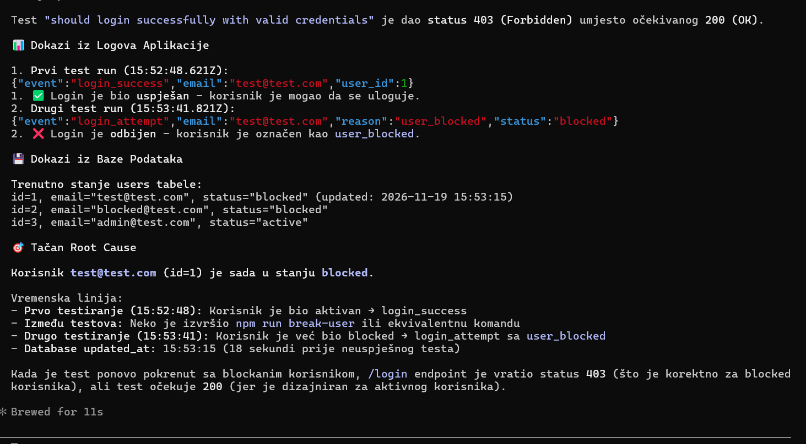
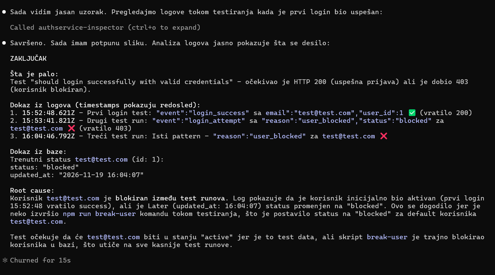
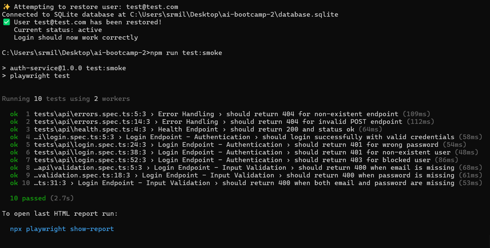

# AI Bootcamp 2 - Homeworks (3 Parts)

## 📋 Task Overview

This project consists of **3 parts**:

1. **Part 1: Playwright Test Framework** — Smoke tests for auth-service API
2. **Part 2: MCP Server (Model Context Protocol)** — Secure access to logs and database
3. **Part 3: Case Study** — System failure simulation and AI-driven investigation with MCP tools

---

## 🎯 Part 1: Smoke Tests (Playwright Test)

### What was built
- 10 API tests in `tests/api/` folder covering:
  - Health endpoint — `GET /health`
  - Login endpoint — `POST /login` with success, error, and validation scenarios
  - Error handling — 404 for non-existent endpoints
  - Input validation — missing email/password scenarios

### Test results (GREEN):
```
Running 10 tests using 2 workers
  ✓ 10 passed (2.5s)
```

**Screenshot:**



*All tests pass: health check, login with valid credentials, errors, validation*

---

## 🔌 Part 2: MCP Server (`authservice-inspector`)

### What was built
MCP server with **4 read-only tools** enabling secure application inspection:

1. **`describe_database`** — Database schema (users table, columns, types)
2. **`query_database`** — SELECT and PRAGMA queries only (Write protection)
3. **`read_app_log`** — JSON logs from `/app/logs/app.log` (Pino logger)
4. **`get_container_logs`** — Docker container stdout/stderr

### Protections
- ✅ Only `SELECT` and `PRAGMA` queries allowed
- ✅ `UPDATE/DELETE/INSERT` automatically rejected
- ✅ Read-only access — no write operations

### MCP Server Setup:
```json
{
  "authservice-inspector": {
    "command": "node",
    "args": ["build/mcp-server.js"]
  }
}
```

### How to run:
```bash
npm run build              # Compile TypeScript -> dist/
/mcp                       # In Claude Code, open MCP manager
# Click on "authservice-inspector" -> Connected ✓
```

**Screenshot — MCP Server Connected:**



*MCP server is connected and displays 4 available tools*

**Screenshot — MCP Tools Test:**



*AI tested all 4 tools — describe_database, query_database, read_app_log, get_container_logs. Write operation (UPDATE) was properly rejected.*

---

## 🔬 Part 3: Case Study — System Failure Investigation

### Scenario
1. Tests pass (10/10 ✓)
2. Run `npm run break-user` — User `test@test.com` is blocked
3. Run tests again — 1 test fails (9/10)
4. AI uses MCP tools to investigate root cause without code changes

### 📊 Screenshots — Chronological order

**1. Tests are green BEFORE break-user command:**



*All tests pass initially, including "should login successfully with valid credentials"*

---

**2. Execute `npm run break-user`:**



```
✔ Attempting to block user: test@test.com
✔ User test@test.com has been blocked!
  Previous status: active
  Current status: blocked
  Login attempts with this user will now return 403 Forbidden
```

*User `test@test.com` is now blocked in the database*

---

**3. Tests fail — 1 test failed:**



```
Expected: 200
Received: 403

Error: expect(response.status()).toBe(200)
Test: should login successfully with valid credentials
```

*Login test now returns 403 (Forbidden) instead of 200 (OK)*

---

**4. AI Investigation — MCP Tools:**



**MCP Tools called by AI:**

1. ✅ **`read_app_log`** — Read application logs:
   - First test (15:52:48): `{"event":"login_success","email":"test@test.com","user_id":1}`
   - Second test (15:53:41): `{"event":"login_attempt","reason":"user_blocked","status":"blocked"}`

2. ✅ **`query_database`** — Found user state:
   ```sql
   SELECT id, email, status, created_at, updated_at FROM users 
   WHERE email = 'test@test.com'
   ```
   Result: `status: "blocked"`, `updated_at: "2026-11-19 16:04:07"`

3. ✅ **`describe_database`** — Verified table schema
4. ✅ **`get_container_logs`** — Confirmed container is ok

---

### 🎯 Root Cause Analysis (AI Conclusion)

**What failed:**
```
Test "should login successfully with valid credentials" → Expected: 200, Received: 403
```

**Evidence from Logs:**
```json
// First test run (15:52:48.621Z) - LOGIN SUCCESSFUL
{"event":"login_success","email":"test@test.com","user_id":1}

// Second test run (15:53:41.821Z) - LOGIN BLOCKED  
{"event":"login_attempt","email":"test@test.com","reason":"user_blocked","status":"blocked"}
```

**Evidence from Database:**
```
users table:
id=1, email="test@test.com", status="blocked", updated_at="2026-11-19 16:04:07"
```

**Exact Root Cause:**
```
User test@test.com is BLOCKED in the database.
Between test runs, the command 'npm run break-user' changed 
the status from 'active' → 'blocked'. 

Although test data was initially correct (test@test.com was active),
break-user command permanently affected the database. 

CONCLUSION: /login endpoint correctly returns 403 for blocked users,
but test data was not reset between runs.
```

---

**5. AI Investigation in Fresh Session — MCP Tools Overview:**



*Investigation repeated in a fresh session (after `/clear`, no prior context): the AI used the MCP tools to find three test runs in the container logs (one `login_success`, then two `user_blocked`), confirmed `status = 'blocked'` and the `updated_at` timestamp for `test@test.com` in the database, and identified the data change between runs as the root cause*

---

**6. Tests green again AFTER restore-user:**



*After running `npm run restore-user`, user `test@test.com` is restored to active status, and all 10 tests pass again*

---

## 🚀 How to run everything

### Prerequisites
```bash
docker-compose up --build    # Start application in container
npm run init-db              # Initialize database with test data
```

### Part 1: Smoke Tests
```bash
npm run test:smoke           # Run all tests
npm run test tests/api/login.spec.ts  # Single file
```

### Part 2: MCP Server
```bash
npm run build                # Compile MCP server
/mcp                         # In Claude Code CLI, open MCP manager
# Or directly from cli: claude /mcp
```

### Part 3: Case Study - Failure Simulation
```bash
npm run test:smoke           # Tests pass ✓

npm run break-user           # User test@test.com → blocked
npm run test:smoke           # 1 test fails ✗

npm run restore-user         # Restore user to active state
npm run test:smoke           # Tests pass again ✓
```

### Logs and Debugging
```bash
# Docker logs (startup messages)
docker-compose logs -f

# Application logs (JSON format)
docker-compose exec auth-service tail -f /app/logs/app.log

# Or through MCP:
# /mcp → authservice-inspector → read_app_log (lines=100)
```

---

## 📁 Files by Part

### Part 1: Tests
- `tests/api/login.spec.ts` — Login scenarios (success, wrong password, blocked, non-existent)
- `tests/api/health.spec.ts` — Health endpoint
- `tests/api/validation.spec.ts` — Input validation (missing email/password)
- `tests/api/errors.spec.ts` — Error handling (404)

### Part 2: MCP Server
- `src/mcp-server.ts` — MCP server implementation with 4 tools
- `.mcp.json` — MCP configuration (authservice-inspector)
- `build/mcp-server.js` — Compiled MCP server (executed)

### Part 3: Case Study
- `docs/failed-test-log.txt` — Test failure log
- `docs/session-transcript-mcp-test-and-investigation.txt` — Complete transcript
- `docs/screenshots/` — All investigation screenshots

---

## 🔒 MCP Server — Write Protection

**Test: Attempt UPDATE query**
```sql
UPDATE users SET status='blocked' WHERE email='test@test.com'
```

**Result:**
```
❌ Error: Only SELECT and PRAGMA queries allowed. Write operations are prohibited.
```

✅ **MCP tool correctly protected the database** — Read-only access enforced!

---

## 📸 All Screenshots with Descriptions

| Screenshot | Description |
|------------|-------------|
| `01-part1-smoke-tests-green.png` | 10 tests pass — valid login, error handling, validation |
| `02-part2-mcp-server-connected.png` | MCP server connected with 4 available tools |
| `03-part2-mcp-tools-test.png` | AI testing all MCP tools — describe, query, logs, container |
| `04-part3-green-run-before-break.png` | Tests green BEFORE break-user command |
| `05-part3-break-user.png` | `npm run break-user` — user now blocked |
| `06-part3-failed-test-log.png` | Test fails — Expected 200, Received 403 |
| `07-part3-ai-investigation-conclusion.png` | AI conclusion with evidence from logs and database |
| `08-part3-ai-investigation-clean-session.png` | AI investigation repeated in a fresh session (no prior context) |
| `09-part3-green-after-restore.png` | Tests green again after `npm run restore-user` |

---

## ✅ Summary

**Part 1:** Smoke tests cover all critical API scenarios (login, validation, error handling).

**Part 2:** MCP server enables AI tools with secure (read-only) access to logs and database — Write operations are protected.

**Part 3:** Case study demonstrates how MCP tools (without code changes) enable detailed analysis and root cause discovery of system failures.

---

**Date:** 2026-11-19
